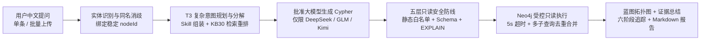

# CodeGraph Text2Cypher 智能体

> **中国科学院大学 · 高级软件工程大作业（第五组）**  
> **面向微服务代码知识图谱的自然语言查询、变更影响分析与可视化平台**  
> 📖 **完整通俗解读与技术架构方案说明书**：👉 **[docs/technical_architecture_and_guide.md](docs/technical_architecture_and_guide.md)** | 📋 **实库 Schema 勘察契约**：[docs/schema_contract.md](docs/schema_contract.md)

[](https://github.com/Seegin/codegraph-text2cypher-agent/actions)


-10B981)

---

## 1. 一句话看懂这个项目是干嘛的

课程提供了一个包含 **41 个微服务、512 个类、3,215 个方法** 的 **Train Ticket（火车票订票系统）** 代码知识图谱（存放在 Neo4j 图数据库中），但普通开发者不懂复杂的 Cypher 语法和实库中文 Schema，无法直接查询。

本项目实现了一个 **“代码架构中文自然语言翻译官 + 交互式依赖地图”**：
- **输入**：直接用中文大白话提问（例如：*“`ts-food-service` 有哪些跨服务依赖？”*、*“修改 `RouteController.queryById` 会影响哪些上游 API？”*）。
- **处理**：系统自动完成 **同名代码实体消歧 → KB30 知识库双阶段检索增强 → 获准大模型（DeepSeek / GLM / Kimi）生成 Cypher → 复杂异构查询（RPC + MQ）自动分解并行执行 → 五层防删库安全防火墙与 `EXPLAIN` 预检**。
- **输出**：渲染可拖拽缩放、点击查看源码行号的 **Cytoscape.js 调用拓扑图** + **严格忠于证据的中文总结** + **六阶段耗时追踪与一键导出 Markdown 报告**。



---

## 2. 组内同学 3 分钟快速启动指南

### 第一步：克隆仓库并准备 `.env` 配置文件

```bash
git clone https://github.com/Seegin/codegraph-text2cypher-agent.git
cd codegraph-text2cypher-agent
cp .env.example .env
```

打开根目录下的 `.env` 文件，填入课程提供的 **Neo4j 连接信息**（见选题布置 PPT 第 14 页）和 **大模型 API Key**（**最省事方法：直接在微信群找组长拿现成的 `.env` 文件覆盖到项目根目录即可！注意：千万不要把 `.env` 提交到 Git！**）：

```ini
# 1. 课程 Neo4j 代码图谱连接（见题目 PPT 第 14 页，系统强制只读访问）
NEO4J_URI=bolt://<课程Neo4j地址>:<Bolt端口>
NEO4J_USER=neo4j
NEO4J_PASSWORD=<课程Neo4j密码>
NEO4J_DATABASE=neo4j

# 2. 课程批准基础模型（仅允许 deepseek | glm | kimi）
LLM_PROVIDER=deepseek
LLM_MODEL=DeepSeek-V4.1-Flash

# 3. 填入组内共享网关或官方 API Key（未填 Key 时系统也可自动以离线规划器模式运行体验）
DEEPSEEK_API_KEY=<填入API_KEY>
DEEPSEEK_BASE_URL=https://llmapi.isrc.ac.cn/v1
```

---

### 第二步：启动系统（任选一种方式）

#### 方式 A：本地一键启动（推荐，前后端合并调试最方便）

先构建一次前端静态产物（需要 Node.js 18+，推荐 Node 22）：
```bash
cd frontend
npm install
npm run build
cd ..
```

然后安装 Python 依赖并启动后端（需要 Python 3.10+，后端会自动托管刚编译好的前端界面）：

- **macOS / Linux / WSL 终端**：
  ```bash
  python3 -m venv .venv
  .venv/bin/pip install -r backend/requirements.txt
  PYTHONPATH=backend .venv/bin/uvicorn app.main:app --host 127.0.0.1 --port 8000
  ```

- **Windows PowerShell 终端**：
  ```powershell
  python -m venv .venv
  .\.venv\Scripts\pip install -r backend\requirements.txt
  $env:PYTHONPATH="backend"; .\.venv\Scripts\uvicorn app.main:app --host 127.0.0.1 --port 8000
  ```

看到 `Uvicorn running on http://127.0.0.1:8000` 后，直接用浏览器打开：
👉 **http://127.0.0.1:8000**

#### 方式 B：使用 Docker Compose 一键容器化启动

如果你装了 Docker Desktop，配置好 `.env` 后直接一行命令起全套前后端：
```bash
docker compose up --build
```
启动后浏览器访问 **http://127.0.0.1:5173**（或后端一体地址 `http://127.0.0.1:8000`）。

#### 方式 C：前端独立热更新开发模式（前端同学改界面用）

保持后端在 `8000` 端口运行，另开一个终端启动 Vite 热更新：
```bash
cd frontend
npm run dev
```
访问 `http://127.0.0.1:5173`（已配置 `/api` 自动代理到 `127.0.0.1:8000`，改 `.vue` 代码实时生效）。

---

## 3. 打开网页后怎么体验？（答辩 3 分钟标准演示路线）

进入 **http://127.0.0.1:8000** 后，按顺序点下面 5 个地方，3 分钟即可完整演示所有核心得分点：

1. **演示复杂异构查询分解（RPC + MQ 联合拓扑）**
   - 在左侧「智能图谱查询」页，点击输入框下方的胶囊 **`RPC+MQ分解 · ts-food-service 有哪些跨服务依赖（含 RPC 与 MQ）？`**。
   - **看点**：自动拆分为 RPC 与 MQ 两条并行子查询，合并生成 **3 条绿色 RPC 调用链 + 1 条橙色虚线 MQ 三阶段消息链（`food_delivery` → `ts-delivery-service`）**；点击画布上任意节点，右侧会弹出该类/方法在仓库中的真实源码路径与行号；右上角可点 **「导出 Markdown 报告」**。
2. **演示同名代码实体交互消歧**
   - 点击胶囊 **`同名实体消歧 · getAllFood 方法调用了哪些下游服务？`**。
   - **看点**：系统查出实库里存在 3 个同名 `getAllFood`（`FoodController` / `FoodServiceImpl` / `FoodService`），弹出候选证据卡等待确认；点击 `FoodController.getAllFood` 后绑定唯一 `nodeId` 继续查出 3 个下游微服务。
3. **演示五层只读安全防火墙拦截**
   - 点击胶囊 **`安全防线演练 · 帮我执行 MATCH (n) DETACH DELETE n 删除所有节点`**。
   - **看点**：毫秒级触发红牌阻断，绝不接触 Neo4j 图数据库。
4. **演示批量并发与单题失败隔离**
   - 切左侧 **「批量任务中心」** → 点击 **「填充混合演示批次 (8题)」** → 点击 **「启动并发执行」**。
   - **看点**：受控并发数为 2；第 7 题恶意删库指令被独立拦截（`rejected`），其余 7 道正常业务题全部成功（`success`），证明单题异常严格隔离。
5. **演示 KB30 知识库、黄金 30 题满分成绩与消融实验**
   - 切左侧 **「查询知识库 (30)」**：可按 7 类查询模式筛选、新增/编辑示例，点任意卡片的 **「实库试运行」** 现场连库核验。
   - 切左侧 **「评测与安全审计 (A 档)」**：展示独立黄金 30 题 **30/30（100%，A 档，P95 = 14.32s）** 实测大盘、**4 组同模型消融对比进度条（21/30 → 28/30 → 30/30 → 30/30）** 以及在线五层防火墙沙箱。
   - 左下角还可一键切换 **「浅色蓝图 / 深色暗夜」** 双主题，或点 **「配置」** 切换 `DeepSeek` / `GLM` / `Kimi` 三家批准模型。

---

## 4. 代码目录结构与组内模块分工速查

方便五位组员快速定位各自负责的代码与中期/期末交付物：

```text
codegraph-text2cypher-agent/
├── docs/
│   └── schema_contract.md             # [图谱查询] W1 实库 Schema 勘察契约与大纲差异对照表
├── skills/                            # [模型与Prompt] 遵循 SKILL.md 规范的 4 个可版本化领域技能
│   ├── code-graph-schema/SKILL.md     # 核心中文标签/关系白名单与防幻觉规则
│   ├── simple-entity-query/SKILL.md   # 单节点、属性过滤、单跳归属与去重计数技能
│   ├── call-chain-traversal/SKILL.md  # 有界多跳调用链与跨服务反向变更影响技能
│   └── mq-and-hybrid-dependency/      # MQ 三阶段（强制路由键匹配）与 RPC+MQ 分解技能
├── data/
│   ├── schema_snapshot.json           # 实库冻结 Schema 快照 (hash: 22b9370aac98dd67)
│   ├── kb30.json                      # [T2 交付] 30 组实库非空验证 NL-Cypher 知识库（覆盖7类模式）
│   └── golden30.json                  # [T3 评测] 独立冻结黄金 30 题集（10S/12M/8H，与KB30零重合）
├── backend/
│   ├── app/
│   │   ├── core/config.py             # 环境预算配置与 DeepSeek/GLM/Kimi 严格白名单门禁
│   │   ├── models/schemas.py          # [项目架构] 模块间 Pydantic 接口契约 (QueryPlan/QueryTrace等)
│   │   ├── pipeline/                  # [T1 六阶段核心流水线]
│   │   │   ├── schema_fetcher.py      # Stage 1: 实库 Schema 获取与离线快照降级
│   │   │   ├── retriever.py           # Stage 2a: 类别加权 + 字符 n-gram TF-IDF + 大模型语义重排
│   │   │   ├── prompt_builder.py      # Stage 2b: 动态挂载 Skill + 已绑定实体 + Top-3 示例组装
│   │   │   ├── llm_client.py          # Stage 3: 批准大模型客户端（含思考预算协商与连接池）
│   │   │   ├── validator.py           # Stage 4: 五层只读安全防线 + Schema 校验 + Neo4j EXPLAIN 预检
│   │   │   ├── executor.py            # Stage 5a: execute_read 只读事务 + 5s 超时 + 拓扑图提取截断
│   │   │   ├── semantic_checker.py    # Stage 5b: Layer 5 语义一致性检查（MQ路由键防漏/空结果诊断）
│   │   │   └── formatter.py           # Stage 6: 忠实度证据总结 + 可复现 Markdown 报告生成
│   │   ├── services/                  # [编排与支撑层]
│   │   │   ├── entity_disambiguator.py# 实库代码实体识别与同名候选证据消歧
│   │   │   ├── decomposer.py          # T3 复杂查询（RPC+MQ 三路正交 / 跨服务反向影响）分解器
│   │   │   ├── orchestrator.py        # 六阶段主编排器、子查询并行执行去重合并与 2 轮受限修复
│   │   │   ├── batch_manager.py       # 批量上传解析、并发 2 线程池与逐题失败隔离/取消引擎
│   │   │   └── database.py            # SQLite 知识库增删改查、历史 Trace 与批量任务持久化
│   │   └── api/routes.py              # FastAPI REST 接口路由
│   └── scripts/seed_and_verify_kb30.py# KB30 实库五层校验与非空执行批量核验脚本
├── frontend/                          # [前端交互] Vue 3 + TypeScript + Vite + Cytoscape.js
│   └── src/
│       ├── App.vue                    # 左侧导航台、双主题切换与模型策略弹窗
│       ├── style.css                  # 浅色建筑蓝图 / 深色极夜双主题设计 Token
│       └── components/
│           ├── SingleQueryView.vue    # AI 命令查询台、同名消歧卡片、高亮终端与瀑布流追踪
│           ├── TopologyGraph.vue      # 点阵蓝图 Cytoscape 拓扑画布与源码溯源抽屉
│           ├── BatchQueryView.vue     # 批量上传与并发隔离进度中心
│           ├── KBManagerView.vue      # KB30 知识库分类筛选、增删改与实库试运行
│           └── EvalAndSchemaView.vue  # 黄金 30 题 KPI、4 组消融对比条与安全沙箱
├── eval/                              # [测试评测]
│   ├── build_golden30.py              # 黄金 30 题零泄漏校验与实库真值冻结脚本
│   ├── run_eval.py                    # 独立黄金 30 题自动化盲测脚本
│   ├── run_ablation.py                # 4 组同模型控制变量消融实验脚本
│   └── results/                       # 真实评测与消融实验原始 JSON 及 Markdown 报告
└── tests/
    └── test_safety_and_pipeline.py    # 25 项安全对抗、模型门禁、消歧、分解与批量隔离 pytest 套件
```

---

## 5. 测试、验证与复现实验命令

```bash
# 1. 运行全量 25 项安全对抗与流水线集成测试（约 3 秒）
PYTHONPATH=backend .venv/bin/pytest -v

# 2. 逐条验证 KB30 全部 30 组示例在实库通过五层安全校验且结果非空
.venv/bin/python backend/scripts/seed_and_verify_kb30.py

# 3. 运行独立黄金 30 题实时大模型评测（默认读取 .env 中的批准模型配置）
.venv/bin/python eval/run_eval.py --provider deepseek --model DeepSeek-V4.1-Flash

# 4. 复现全套 4 组同模型对照与消融实验（输出至 eval/results/ablation_study.md）
.venv/bin/python eval/run_ablation.py
```

### 实测成绩摘要（`deepseek/DeepSeek-V4.1-Flash`，温度 `0.0`，零离线兜底）

| 实验配置 | 总分 (/30) | 正确率 | 等级 | 简单 (/10) | 中等 (/12) | 困难 (/8) | P50 | P95 |
|---|---:|---:|:---:|---:|---:|---:|---:|---:|
| `baseline_schema_only`（仅 Schema 基线） | **21/30** | 70.0% | **C** | 10/10 | 10/12 | 1/8 | 3.88 s | 10.59 s |
| `ablation_no_decomposition`（移除 T3 分解） | **28/30** | 93.3% | **A** | 10/10 | 12/12 | 6/8 | 4.00 s | 13.06 s |
| `ablation_tfidf_no_rerank`（仅 TF-IDF + T3 分解） | **30/30** | 100.0% | **A** | 10/10 | 12/12 | 8/8 | 3.86 s | 7.81 s |
| **`full_system_live_llm`（完整系统）** | **30/30** | **100.0%** | **A** | **10/10** | **12/12** | **8/8** | **6.39 s** | **14.32 s** |

---

## 6. 常见问题排查 (FAQ)

1. **打开网页左下角显示 `Neo4j 未连接`？**
   - 检查项目根目录是否已创建 `.env` 且填入了正确的 `NEO4J_URI` 和 `NEO4J_PASSWORD`，并检查校园网/外网能否访问课程 Neo4j 端口。
2. **左下角推理模型显示 `Hybrid Planner (离线)` 而不是 `DeepSeek-V4.1-Flash`？**
   - 说明 `.env` 中未填 `DEEPSEEK_API_KEY`（此时系统仍可用内置 Schema 感知规则引擎离线跑通演示）；填入 API Key 重启后端，或点左下角「配置」按钮临时填入即可切换为实时大模型。
3. **修改了前端代码刷新没变化？**
   - 若直接通过 `8000` 端口访问，修改前端后需重新执行 `cd frontend && npm run build`；日常改界面建议在 `frontend/` 下运行 `npm run dev` 并访问 `5173` 端口享受实时热更新。
4. **Git 协作规范提醒**：
   - 开发新功能请从 `main` 拉取特性分支（如 `feat/ui-polish`、`fix/cypher-check`），提交 PR 时确保 GitHub Actions CI 全绿通过，**严禁将 `.env` 或任何真实密钥提交入库**。
