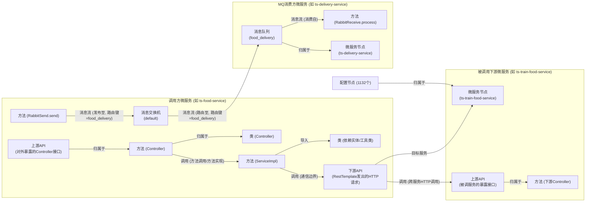
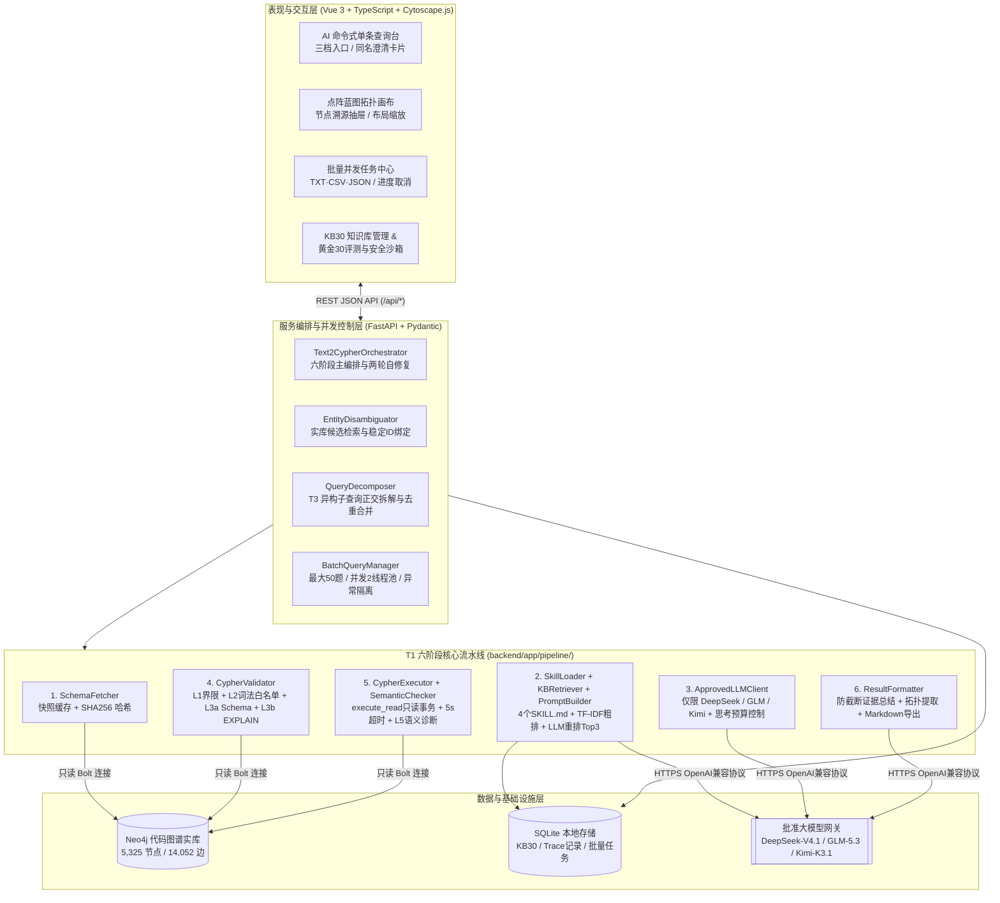
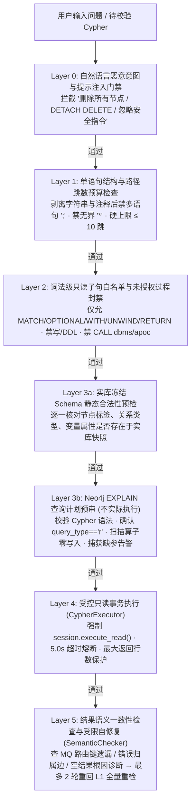

# 面向代码图谱的 Text2Cypher 查询智能体 —— 全面技术方案与通俗解读手册

> **课程名称**：中国科学院大学 · 高级软件工程（2026 秋季学期）  
> **项目团队**：第五组（岳卓佳、梁献中、成政翰、邓新超、高研盛）  
> **文档定位**：集 **“零基础通俗科普 + 系统架构设计说明书 + 核心算法与安全方案 + 实测消融报告 + 答辩应答宝典”** 于一体的完整技术文档。组内任何同学花 15 分钟读完本文，即可彻底掌握本项目的业务价值、代码脉络与技术亮点。

---

## 目录

1. [通俗全景解读：用一个比喻讲透我们在做什么](#1-通俗全景解读用一个比喻讲透我们在做什么)
2. [实库代码图谱大白话图解与 W1 勘察关键发现](#2-实库代码图谱大白话图解与-w1-勘察关键发现)
3. [系统总体架构、技术选型与接口契约](#3-系统总体架构技术选型与接口契约)
4. [T1 端到端六阶段流水线深度技术方案](#4-t1-端到端六阶段流水线深度技术方案)
5. [五层纵深只读安全防线设计方案](#5-五层纵深只读安全防线设计方案)
6. [T2 查询知识库（KB30）建设与双阶段检索方案](#6-t2-查询知识库kb30建设与双阶段检索方案)
7. [T3 复杂查询分解、异构合并与批量隔离方案](#7-t3-复杂查询分解异构合并与批量隔离方案)
8. [前端双主题建筑蓝图工作台与交互设计](#8-前端双主题建筑蓝图工作台与交互设计)
9. [独立黄金 30 题评测、真实调优复盘与消融实验](#9-独立黄金-30-题评测真实调优复盘与消融实验)
10. [答辩高频追问标准应答手册与二次开发指南](#10-答辩高频追问标准应答手册与二次开发指南)

---

## 1. 通俗全景解读：用一个比喻讲透我们在做什么

### 1.1 现实痛点：为什么需要这个系统？

想象我们要维护一套超大型的 **“12306 火车票订票系统”（复旦大学开源的 Train Ticket 微服务基准系统）**：
- 这套系统被拆成了 **41 个独立的微服务**（管车次的、管车站的、管订票的、管退票的、管餐食的、管发邮件通知的……），里面有 **512 个 Java 类、3,215 个方法**。
- 服务与服务之间有两种完全不同的“说话方式”：
  1. **同步打电话（HTTP / REST / RPC 调用）**：比如“订票服务”直接发 HTTP 请求问“餐食服务”有哪些盒饭。
  2. **异步寄快递（RabbitMQ 消息队列 / MQ）**：比如“餐食服务”往 `food_delivery` 队列里丢一条消息，“配送服务”在后台悄悄收走处理。

**日常开发中最头疼的三个灵魂拷问**：
1. *“我是新来的开发，想知道 `getAllFood` 这个方法背后到底调用了下游哪几个微服务？”*
2. *“我现在要改 `BasicController.queryForTravel` 的参数，一旦改了，会把上游哪几个对外暴露的接口弄崩？”*（变更影响分析）
3. *“`ts-food-service` 跟整个系统里哪些微服务有耦合？不管是同步 HTTP 还是异步 MQ 都要找出来，不能漏！”*

为了帮大家理清这团乱麻，课程组提前用静态代码分析工具把整套代码抽成了一张巨大的关系网——**代码知识图谱（Code Graph）**，存进了 **Neo4j 图数据库**（5,325 个节点 + 14,052 条关系边）。

**但新的难题来了**：
Neo4j 就像一张只有专业测绘员才看得懂的加密地图，想查它必须手写几十行 **Cypher 图查询语言**，还得背熟里面所有的中文节点标签、边方向和隐藏属性。普通程序员根本不会写，写错了还可能漏掉链路甚至误删数据。

### 1.2 我们的解决方案：做代码图谱的“高德语音导航”

我们研发的 **CodeGraph Text2Cypher 智能体**，本质上就是在开发者与 Neo4j 代码图谱之间架起一座 **“自然语言安全翻译与可视化桥梁”**：

| 传统人工查图谱方式 | 使用本智能体工具后 |
|---|---|
| 需背诵 8 种节点标签、8 种关系、上百个属性字段名 | **零门槛**：直接输入中文大白话提问 |
| 遇到同名方法（如 36 个微服务都有 `home` 方法）极易查串 | **自动消歧**：自动查库弹出同名候选卡片（含类名/服务/文件路径），点选确认 |
| 手写跨服务 RPC + MQ 混合查询极易写反方向或漏配路由键 | **智能分解**：自动拆成多路正交子查询并发生成、校验、去重合并 |
| 直接连库手敲命令有误执行 `DELETE` 删库风险 | **五层防线**：词法白名单 + Schema 预检 + `EXPLAIN` 计划检查 + 只读事务 |
| 返回冰冷的 JSON 文本，看不出调用拓扑 | **蓝图可视化**：渲染交互式彩色拓扑图 + 证据总结 + 一键导出 Markdown 报告 |

### 1.3 一条问题在系统内部的“8 秒奇幻漂流”

当你在网页输入框敲下：**“`ts-food-service` 有哪些跨服务依赖（含 RPC 与 MQ）？”** 并点击「生成并查询」后，后台在约 7 秒内依次完成了这 6 件事：

1. **第 1 站 · 读地图说明书（Schema 获取器，< 1 ms）**：确认当前实库版本为 `master-to-dd92845`，拿到全部合法标签与关系契约。
2. **第 2 站 · 认人名 & 防捣乱（安全门禁 + 实体消歧，~5 ms）**：确认你不是来删库的，并在 41 个真实微服务中精准锁定 `svc:ts-food-service`。
3. **第 3 站 · 拆任务 & 翻参考书（T3 分解 + Skill 挂载 + KB30 检索，~900 ms）**：
   - 编排器发现这是“同步 RPC + 异步 MQ”混合难题，把它拆成 **子任务 A（查同步 RPC 出向依赖）** 和 **子任务 B（查异步 MQ 发布消费链路）**；
   - 从 30 道满分标准例题库（KB30）里，用 TF-IDF + 大模型重排找出最像的 3 道例题（如 `KB27`、`KB28`），连同防错秘籍（`SKILL.md`）一起打包成 Prompt。
4. **第 4 站 · 请批准大模型写代码（并行调用 `DeepSeek-V4.1-Flash`，~3.5 s）**：两条子任务**同时**发给大模型，各自生成一条参数化只读 Cypher。
5. **第 5 站 · 过五道安检门 & 查数据库（Validator + Executor，~80 ms）**：
   - 检查有没有危险词、标签对不对、让 Neo4j `EXPLAIN` 预演执行计划确认纯只读；
   - 在 5 秒超时保护的只读事务中查出结果，自动把两条子查询的结果去重合并成 **4 条跨服务依赖记录、11 个拓扑节点、6 条关系边**（万一第一次写错了还会自动把报错喂回给大模型修复，最多修 2 次）。
6. **第 6 站 · 画蓝图 & 写总结报告（Formatter，~2.2 s）**：把精简后的真实证据交给大模型写成不吹不黑的中文结论，连同点阵蓝图拓扑、六阶段耗时瀑布流一起推给前端渲染！

---

## 2. 实库代码图谱大白话图解与 W1 勘察关键发现

### 2.1 实库真实图谱结构全景图（8 种节点 · 8 种关系）

我们在第一周（W1 门禁）直连课程实库（`Neo4j 2026.06.0`）做全量只读勘察后，摸清了图谱真实的“长相”：

**几个容易混淆的核心概念（用大白话记住）**：
- **`上游API` vs `下游API`**：
  - **`上游API`（262 个）** = **“别人来调我的大门”**（即 Controller 上的 `@GetMapping` / `@PostMapping` 接口，通过 `[:归属于]` 连向处理它的 Controller 方法）。
  - **`下游API`（157 个）** = **“我打给别人的电话”**（即代码里用 `RestTemplate.exchange(...)` 发起的外部 HTTP 调用点，通过 `[:目标服务]` 连向目标 `微服务`，并通过 `[:调用 {关系语义:'跨服务HTTP调用'}]` 连向对方的 `上游API`！）。
- **MQ 三阶段 `[:消息流]`**：
  - 第一棒 **发布**：`(发送方法)-[:消息流 {消息流类型:'发布至', 路由键:'food_delivery'}]->(消息交换机)`
  - 第二棒 **路由**：`(消息交换机)-[:消息流 {消息流类型:'路由至', 路由键:'food_delivery'}]->(消息队列)`
  - 第三棒 **消费**：`(消息队列)-[:消息流 {消息流类型:'消费自'}]->(接收方法)`

### 2.2 为什么必须做实库勘察？（实库 vs 题目简述的 7 处致命差异）

如果直接照搬题目介绍 PPT 里的概略名词去写 Prompt，大模型生成的 Cypher 在实库上会 **100% 报错或返回空集**！我们在 W1 勘察发现并固化的 7 处核心差异如下（详见 [schema_contract.md](schema_contract.md)）：

| 序号 | 题目初始简述 | 实库真实结构 (`master-to-dd92845`) | 我们的工程防错设计 |
|---:|---|---|---|
| 1 | 节点叫 `API 端点` | 实库拆分为 **`上游API`** 与 **`下游API`** | 在 `code-graph-schema/SKILL.md` 明确区分暴露入口与外部调用点 |
| 2 | 节点含 `配置文件节点`、`测试用例` | 实库标签名为 **`配置`**，且 **不存在任何 `测试用例` 节点** | Schema 校验器在执行前直接拦截虚构标签并给出合法标签提示 |
| 3 | 节点叫 `消息通信交换机` | 实库标签名为 **`消息交换机`**（全库仅 1 个 `(default)` 节点） | 固化进冻结快照与实体映射词典 |
| 4 | 关系叫 `归属` / 英文示例 `CALLS` | 实库关系名为 **`归属于`** 与中文 **`调用`**，且新增 **`目标服务`**、**`链中下一节点`** 共 8 种 | 严禁英文 `CALLS`；预检层自动校验关系名合法性 |
| 5 | 以为 `(类)-[:归属]->(微服务)` 存在 | **`类` 与 `方法` 根本没有指向 `微服务` 的边！** 归属信息存在数组属性 `serviceContexts` 和 `moduleId` 上 | 在 Skill 与 Layer 5 语义检查器中强制约束用 `$service IN n.serviceContexts` 过滤 |
| 6 | 直接写 `(m1)-[:调用*]->(m2)` 查调用链 | `[:调用]` 同时连向 `配置`（169条）和 `上游API`（262条），盲目遍历会窜入配置节点 | 强制附加 `ALL(rel IN rs WHERE rel.关系语义 IN ['方法调用','方法实现']) AND ALL(x IN nodes(p) WHERE x:方法)` |
| 7 | 直接连 `(交换机)-[:消息流]->(队列)` | 全系统所有队列共享同一个 `(default)` 交换机！不加过滤会把发邮件的 `email` 消息串到送外卖的 `food_delivery` 队列上！ | 在 Skill 与 Layer 5 语义检查器双重强制要求 **`WHERE r1.路由键 = r2.路由键`** |

---

## 3. 系统总体架构、技术选型与接口契约

### 3.1 四层模块化系统架构

### 3.2 技术栈选型与边界说明

| 层次 | 选用技术 | 选型理由与课程合规性 |
|---|---|---|
| **前端界面与拓扑** | `Vue 3` + `TypeScript` + `Vite` + `Cytoscape.js` + `cytoscape-dagre` | 响应式组件清晰，支持有向分层（Dagre LR/TB）与力导向图渲染，节点/边点击直接联动实库属性证据 |
| **后端服务与契约** | `FastAPI` + `Pydantic v2` + `pydantic-settings` | 强类型接口校验、自动 OpenAPI 文档，所有敏感数据库密码与 API Key 仅从运行环境 `.env` 读取 |
| **图数据库访问** | 官方 `neo4j` Python Driver (`v6.x`) | 全程强制使用 `session.execute_read(...)` 只读事务路由 + `timeout=5.0s` 单次查询超时控制 |
| **本地持久化** | Python 内置 `sqlite3` (`data/app.db`) | 零外部运维成本持久化 KB30 示例版本、查询历史追踪（`QueryTrace`）与批量任务状态 |
| **知识检索与技能** | `scikit-learn` (`TfidfVectorizer` 字符 2–4 gram) + 批准大模型重排 + `SKILL.md` | 30 条规模知识库无需额外部署未批准的 Embedding 模型，完美符合课程模型限制且检索精准 |
| **基础大语言模型** | **DeepSeek**（主：`DeepSeek-V4.1-Flash`）、**GLM**（备：`GLM-5.3`）、**Kimi**（备：`Kimi-K3.1-Pro-HighSpeed`） | **100% 遵守课程红线**：配置层与运行期双重拦截任何非三家批准厂商模型 |
| **质量与交付保障** | `pytest` (25项用例) + `Docker Compose` + `GitHub Actions CI` | 本地与云端 CI 自动化回归验证静态安全防线、Schema 契约与数据集零泄漏 |

### 3.3 核心模块数据契约（`backend/app/models/schemas.py`）

各阶段模块不传递松散字典，而是严格通过以下 Pydantic 契约对象交互：
- **`QueryRequest`**：封装用户输入 `question`、难度档位 `level`、可选微服务域 `scope` 及运行策略 `QueryOptions`（最大跳数、是否交互澄清、已选实体 `selected_entity_ids`、模型选择等）。
- **`QueryPlan`**：编排器产出的结构化执行计划，明确 `intent`、`category`、遍历方向 `direction` (`forward`/`reverse`/`both`/`none`)、跳数上限 `max_hops`、已绑定实体列表 `entities`、是否启用分解 `requires_decomposition` 及子查询列表 `subqueries`。
- **`CypherCandidate`**：携带单条生成的 `query`、参数字典 `params`、`schema_hash`、`skill_version`、使用模型 `model_used` 与生成模式（`llm` / `repaired` / `hybrid_planner`）。
- **`ValidationReport`**：记录五层安全检查逐层结果 `layers`、违规分类 `violation_category` 及 Neo4j `EXPLAIN` 算子摘要。
- **`ExecutionResult`**：同时保存完整结果记录 `records`（供评测与统计）与按展示预算（≤100 节点 / 500 边）裁剪后的 `nodes`、`edges`、`paths`，并显式标记 `display_truncated` 与 `complete`。
- **`QueryTrace`**：全链路可复现审计对象，通过唯一 `trace_id` 串联 `schema_hash`、`graph_version`、`skill_versions`、`kb_version`、`model_version`、`code_commit`、检索命中的示例、各阶段毫秒耗时及修复记录。

---

## 4. T1 端到端六阶段流水线深度技术方案

### 4.1 Stage 1：Schema 获取器（`schema_fetcher.py`）
- **实时勘察与确定性指纹**：连接 Neo4j 提取全部节点标签计数、属性集合、关系类型计数、合法三元组模式 `(:src)-[:rel]->(:dst)`、41 个微服务名及 MQ 队列/交换机清单，按字典序规范化后计算 SHA-256 前 16 位作为 `schema_hash`（当前实库固定为 `22b9370aac98dd67`）。
- **离线快照兜底**：若现场网络波动无法连接远端 Neo4j，自动回退读取 `data/schema_snapshot.json` 并显式将 `schema_source` 标记为 `offline_snapshot`，绝不伪装成实时连接。

### 4.2 Pre-Stage：代码实体识别与同名消歧（`entity_disambiguator.py`）
微服务代码中存在大量重名方法（例如实库中有 129 个 `<init>`、41 个 `main`、36 个 `home`，以及 `ts-food-service` 内同时存在 3 个 `getAllFood`）。直接用 `{方法名: 'getAllFood'}` 查图谱极易匹配到抽象接口方法导致返回空结果，或把别的微服务的同名方法混进来。

我们的消歧流程分三步：
1. **多粒度符号抽取**：依次识别问题中的微服务名（匹配实库 41 个服务）、消息队列名（`food_delivery`/`email`）、限定名 `ClassName.methodName`、PascalCase 类名及 camelCase/snake_case 方法名。
2. **实库证据拉取**：只读查询 Neo4j 获取候选节点的完整上下文证据：`nodeId`、`全限定名`、`所属类名`、`serviceContexts`、`来源文件`、`来源行号`、`是否入口方法`、`是否抽象方法`、`类类型`。
3. **双模式决策**：
   - **交互单条查询模式（默认 `clarify_on_ambiguity=True`）**：若收敛后仍有多个候选，立即返回 `status="needs_clarification"`，前端渲染候选卡片由用户点击绑定唯一 `nodeId` 后继续执行；
   - **批量 / 自动评测模式（`clarify_on_ambiguity=False`）**：按方向智能优选具体实现（正向调用优先非抽象的 `CONTROLLER` → `SERVICE_IMPL`；反向影响优先 `SERVICE_IMPL` → `CONTROLLER`，剔除无实现体的纯接口抽象方法），并将绑定结果写入 Trace。

### 4.3 Stage 2：版本化 Agent Skills 与 Prompt 构建（`skill_loader.py` & `prompt_builder.py`）
遵循课程推荐的 **Agent Skill (`SKILL.md`)** 规范，我们将领域规则拆解为 `skills/` 下的 4 个独立技能包（每个均含 YAML frontmatter 版本号与适用范围）：
1. `code-graph-schema@1.0.0`（必选基础技能）：8 种标签/关系白名单、口语到实库字段映射、`serviceContexts` 过滤规则。
2. `simple-entity-query@1.0.0`：单跳归属、枚举过滤与 `count(DISTINCT n.nodeId)` 去重聚合规则。
3. `call-chain-traversal@1.0.0`：有界跳数（`0..6`）、纯 `:方法` 中间节点过滤、下游发现与跨服务反向穿透至 `上游API` 的标准范式。
4. `mq-and-hybrid-dependency@1.0.0`：MQ 三阶段流向与强制 `r1.路由键 = r2.路由键` 关联规则、RPC+MQ 异构联合规范。

`SkillLoader` 根据问题的复杂度与意图类别动态按需挂载对应 Skill，避免无关规则污染模型上下文，同时把激活的 `{skill_name: version}` 记录进 `QueryTrace`。

### 4.4 Stage 3：批准大模型客户端与思考预算自适应优化（`llm_client.py`）
这是我们在接入 `https://llmapi.isrc.ac.cn/v1` 实测过程中打磨最深的核心模块之一：
1. **严格厂商门禁**：仅允许 `deepseek`、`glm`、`kimi` 三个 provider，任何尝试传入 `openai`/`gpt`/`claude`/`qwen` 等非批准模型的请求直接在 `Settings` 和运行时抛出策略拦截异常。
2. **思考型模型（Reasoning Model）截断根因修复**：
   - **实测痛点**：网关上的 `DeepSeek-V4.1-Flash`、`GLM-5.3`、`Kimi-K3.1-Pro-HighSpeed` 默认开启长链思考（Chain-of-Thought），会将上千个 token 消耗在隐藏的 `reasoning_content` 中，不仅单次耗时高达 12–18 秒，还会触发 `finish_reason="length"` 导致最终 JSON `content` 为空或半截截断！
   - **自适应参数协商机制**：
     - 对 `DeepSeek-V4.1-Flash` 自动下发 `extra_body={"thinking": {"type": "disabled"}}`——单次生成耗时从 **12.8s 骤降至 3.8s（提速 3.3 倍）**，输出 token 减少 75%，彻底实现零截断！
     - 对强制思考不可关闭的 `GLM-5.3*` 与 `Kimi-K3*`，自动切换为 `reasoning_effort="low"` 并配足 `max_tokens=4096`；若切换其他兼容网关遇到 400 参数不支持，客户端会自动平滑降级重试，兼顾极速与高兼容性。
3. **连接池复用**：按 `(base_url, api_key)` 缓存复用 `OpenAI` 客户端连接池，省去每次请求的重复 TLS 握手开销。

### 4.5 Stage 6：防截断忠实度总结器（`formatter.py` & `llm_client.py`）
- **实测痛点修复**：Neo4j 返回的原始记录中包含完整的节点与关系对象字典（单行可达上千字符）。若直接将原始 JSON 切片送给总结模型，第 4 行及之后的异构依赖（如 MQ 记录）会被截断丢弃，导致模型误判“未发现 MQ 依赖”。
- **精简证据投影**：在送入总结模型前，先剥离体积庞大的原始图拓扑对象，仅保留每行的标量业务字段与节点 `caption (nodeId)` 摘要，使 30 行完整证据轻松装入 ~1,500 字符上下文中，确保生成的自然语言总结 **100% 覆盖全部证据、零幻觉、零漏报**。

---

## 5. 五层纵深只读安全防线设计方案

> **核心安全原则**：绝不把数据库安全寄托在简单的“禁用词正则替换”或单一的“Prompt 叮嘱”上，而是构建从输入到执行后的 **五层纵深防御体系**（详见 [validator.py](../backend/app/pipeline/validator.py)）。

### 关键安全细节亮点
1. **词法剥离器防误伤与防绕过（`strip_comments_and_strings`）**：
   - 先用状态机剥离 `//...` 单行注释、`/*...*/` 多行注释（防注释混淆注入）和 `'...'` 字符串字面量。
   - 因此合法查询 `MATCH (u:上游API {HTTP方法: 'DELETE'}) RETURN u` 中的字符串 `'DELETE'` **绝不会被误判拦截**；而真正的语句级 `DELETE` / `; MATCH (m) DETACH DELETE m` / `CALL dbms.security.listUsers()` 则 **100% 被精准阻断**（允许安全的 `CALL { ... }` 只读子查询）。
2. **`EXPLAIN` 零副作用预审**：
   - `EXPLAIN` 只让 Neo4j 编译生成执行计划树而不真正触碰数据。我们递归遍历计划树中的每一个 `operator_type`，一旦发现 `CreateNode`、`Merge`、`Delete`、`DetachDelete`、`SetProperty`、`AdministrationCommand` 等任何非只读算子立即阻断；同时提前捕获 `01N60` 参数缺失告警送入自修复闭环。
3. **修复重检铁律**：
   - 触发语义或语法报错时，最多允许大模型自修复 **2 轮**（且恶意写攻击直接拒绝，绝不进入修复！）。每一轮修复产出的新 Cypher **必须重新从 Layer 1 到 Layer 4 完整过检**，杜绝修复阶段引入越权语句。

---

## 6. T2 查询知识库（KB30）建设与双阶段检索方案

### 6.1 30 组高质量实库验证示例分布（`data/kb30.json`）

严格遵循 T2 要求，人工编写了 **30 组** 使用实库真实中文标签与属性的 NL–Cypher 映射，完整覆盖全部 **7 类核心查询模式**，且每一条均通过自动化脚本 [seed_and_verify_kb30.py](../backend/scripts/seed_and_verify_kb30.py) 在实库验证 **五层安全通过 + 执行无错 + 返回结果非空**：

| 查询模式类别 | 数量 | 编号范围 | 典型覆盖问题与关键 Cypher 技巧 |
|---|---:|---|---|
| **1. 单节点查询** | 4 | `KB01`–`KB04` | 全量微服务列表、消息队列归属、微服务内类列表（`serviceContexts`）、同名方法归属类 |
| **2. 属性过滤** | 4 | `KB05`–`KB08` | `类类型='CONTROLLER'`、`是否接口=true`、`HTTP方法='DELETE'`、服务配置节点去重计数 |
| **3. 入口 API 发现** | 4 | `KB09`–`KB12` | 服务暴露的 `上游API -> 方法 -> 控制器类` 两跳归属、各服务入口 API 数量 Top 10 统计 |
| **4. 下游服务发现** | 5 | `KB13`–`KB17` | `getAllFood`/`cancelTicket`/`queryForTravel` 有界多跳下游服务发现、跨服务两跳间接调用链 |
| **5. 反向影响分析** | 4 | `KB18`–`KB21` | 服务级反向调用方、修改 `RouteController.queryById` / `FoodServiceImpl.getAllFood` 受影响上游入口 API |
| **6. MQ 发布者与完整链路** | 5 | `KB22`–`KB26` | 全体 MQ 发布方法、全体消费方法、`food_delivery` 队列三阶段溯源、两服务间定向 MQ 链路 |
| **7. REST + MQ 综合依赖** | 4 | `KB27`–`KB30` | `ts-food-service` / `ts-preserve-service` / `ts-notification-service` 同步 RPC 与异步 MQ 异构依赖汇总 |

### 6.2 免外部向量模型的双阶段混合检索器（`retriever.py`）

为了严格遵守“不得引入未经批准的额外模型”规定，同时兼顾符号匹配精度与图结构语义理解，我们设计了 **两阶段混合检索**：
1. **Stage A（符号与类别粗排）**：使用 `TfidfVectorizer(analyzer="char_wb", ngram_range=(2, 4))` 提取中英文混合字符 n-gram 特征计算余弦相似度，并对与规划器预判 `category` 一致的示例给予 `+0.08` 类别先验加权，快速筛出 Top-8 候选。
2. **Stage B（获准基础模型结构化语义重排）**：将 Top-8 候选的 **`id`、`category`、`intent`、遍历方向 `direction`（`forward`/`reverse`/`both`）与关系模式 `relation_pattern`** 送入当前激活的获准大模型（如 `DeepSeek-V4.1-Flash`），按跳数与方向保真度精选 Top-3 注入生成 Prompt。若未配 Key 则平滑降级为 `tfidf_only` 并在追踪记录中显式标注。

---

## 7. T3 复杂查询分解、异构合并与批量隔离方案

针对单条 Cypher 难以同时准确表达异构通信机制与跨服务多层反向传播的问题，编排层的 `QueryDecomposer` 与 `Text2CypherOrchestrator` 实现了 **正交子查询并行分解 + 归一化去重合并算法**：

### 7.1 场景一：RPC + MQ 跨服务异构依赖分解（双向三路正交拆分）
当用户询问某服务的全量/双向跨服务依赖（如黄金题 `H08`）时，若让大模型在单条语句里拼装复杂的 `UNION`，极易漏掉入向调用或漏写 MQ `路由键` 约束。系统自动将其拆解为 **3 条职责单一的正交子查询**，通过 `ThreadPoolExecutor` **并发向大模型请求生成、独立过五层安检、并发在 Neo4j 执行**：
- **`sq_rpc_out`（同步 RPC 出向）**：恢复该服务经 `方法 -> 下游API -> 目标服务` 主动调用的下游微服务；
- **`sq_rpc_in`（同步 RPC 入向）**：恢复其他微服务经 `下游API -> 目标服务` 调用该服务的入站依赖；
- **`sq_mq_bi`（异步 MQ 双向）**：恢复该服务作为发布方或消费方的完整三阶段 `发布至 -> 路由至(r1.路由键=r2.路由键) -> 消费自` 异步依赖。

### 7.2 场景二：跨服务反向变更影响分解（本地入口 + 跨服务穿透）
当用户询问 *“修改某方法会影响哪些上游入口 API？”*（如黄金题 `H05`、`H06`）时，自动拆解为两路并行子查询：
- **`sq_impact_local`（本服务反向影响）**：沿本服务内部 `[:调用*0..6]`（限定 `方法调用`/`方法实现`）反向找到本服务对外暴露的 `上游API`；
- **`sq_impact_cross`（跨服务上游穿透）**：先找到本服务受影响的 `上游API`，再逆向跨越 `(:下游API)-[:调用 {关系语义:'跨服务HTTP调用'}]->(:上游API)` 定位上游微服务的调用方法 `up_caller`，继续沿上游微服务内部反向调用链穿透至上游微服务的外部入口 `up_api:上游API`！

### 7.3 语义别名自适应归一化合并算法
大模型在不同子查询中可能使用不同的语义列别名（如 `api_id` vs `upstream_api_id`、`target_id` vs `service_id`）。合并引擎首先将常见语义别名映射至规范主键，再结合 `(join_keys + 机制标签 + 全标量字段签名)` 进行确定性去重，并将多路子查询提取出的 `GraphNode`、`GraphEdge`、`PathEvidence` 按稳定 `nodeId` 与 `关系键` 无损融合为一张完整的异构依赖拓扑图。

### 7.4 批量任务受控并发与单题失败隔离（`batch_manager.py`）
- 支持 `.txt`、`.csv`、`.json` 多格式批量导入与多行文本粘贴，硬限制每批 **≤ 50 题**。
- 采用守护线程 + `ThreadPoolExecutor(max_workers=2)` 严格限制并发度为 **2**，保护远端 Neo4j 与大模型网关不被突发流量打满。
- **单题异常绝对隔离**：每道题独立捕获异常与安全阻断状态（如第 7 题为 `DETACH DELETE` 恶意攻击被判 `rejected`，其余正常题目照常完成并落库），支持随时点击「中止当前批次」协作式取消未开始的任务。

---

## 8. 前端双主题建筑蓝图工作台与交互设计

为了让复杂代码图谱关系一目了然，前端摒弃了传统杂乱的后台表格样式，采用 **“建筑工程蓝图（Architectural Blueprint）”** 设计语言重构了全套交互体验：

1. **双主题无缝切换（`style.css` & `App.vue`）**：
   - 默认 **浅色蓝图主题（Blueprint Light）**：柔和瓷白底色 `#F4F6FB` 搭配纯白卡片与靛蓝主色 `#4F46E5`，课堂投影与日常阅读清晰锐利；
   - 可选 **深色暗夜主题（Obsidian Dark）**：中性锌黑 `#09090B` 搭配高对比度胶囊与暗色点阵画布，切换时 Cytoscape 节点与文字配色实时同步重绘。
2. **点阵拓扑画布与溯源抽屉（`TopologyGraph.vue`）**：
   - 20px 点阵网格背景；8 种实体采用高辨识度几何形状与色彩编码；实线绿边代表跨服务 RPC、橙色虚线代表 MQ 消息流、靛蓝实线代表服务内方法调用。
   - 右上角悬浮毛玻璃工具条支持 **左→右分层 / 上→下分层 / 力导向 / 同心环** 四种布局一键切换与缩放自适应；点击任意节点或连线即刻滑出源码文件路径、行号与实库属性证据抽屉。
3. **工程可解释性面板（`SingleQueryView.vue`）**：
   - 内置深色语法高亮 Cypher 终端（一键复制）、五层安全放行绿标步进条、按真实毫秒占比绘制的 **六阶段耗时瀑布流** 及 RAG 相似范例命中卡片。

---

## 9. 独立黄金 30 题评测、真实调优复盘与消融实验

### 9.1 独立黄金 30 题集与防泄漏契约（`data/golden30.json`）
- **严格零泄漏**：黄金 30 题（简单 `S01–S10` 共 10 题、中等 `M01–M12` 共 12 题、困难 `H01–H08` 共 8 题）选用了与 KB30 完全不同的微服务、控制器方法、HTTP 动词与提问句式，自动化测试 `test_kb30_and_golden30_integrity_no_leakage` 每次运行均强制校验两者问题集合交集为空。
- **严格判定口径（`eval/run_eval.py`）**：允许模型生成语义等价的只读 Cypher（不死板比对字符串），但必须同时满足：**① 五层安全与 `EXPLAIN` 校验通过；② 实库完整执行无超时无截断；③ 稳定实体 `nodeId` 集合 / 聚合键值映射 / `(机制, 对端服务)` 配对集合与实库冻结真值 100% 精确相等；④ 自然语言总结非空且忠于证据**。

### 9.2 真实大模型四轮工程调优复盘（从截断受阻到 30/30 满分）

接入课程网关 `deepseek/DeepSeek-V4.1-Flash` 后，我们禁用离线规划器兜底（`allow_planner_fallback=False`，确保 100% 纯实时大模型生成），经历了清晰的四轮工程定位与打磨：

| 迭代轮次 | 纯实时 LLM 得分 | P95 时延 | 暴露出的真实工程问题与根因 | 采取的通用架构修复措施 |
|---|:---:|---:|---|---|
| **Round 1（初始直连）** | 20/30 直通 *(10题截断)* | 54.6 s | `DeepSeek-V4.1-Flash` 默认长链思考耗尽 `max_tokens=1600`，导致 10 道中/难题 JSON 为空且耗时超标 | 实现思考预算自适应协商（`thinking: disabled` / `reasoning_effort: low`）+ T3 子查询线程池并行化 |
| **Round 2（预算修复后）** | **28 / 30** (A档) | 16.1 s | `H05`/`H06` 失败：① 合并器按固定列名 `api_id` 去重，把模型返回的 `upstream_api_id` 折叠成了 1 行；② Skill 缺少跨服务穿透到上游 `上游API` 的明确范式 | 修复合并器支持语义别名归一化与全标量签名去重；完善 `call-chain-traversal/SKILL.md` |
| **Round 3（重排增强后）** | **29 / 30** (A档) | 9.1 s | `H08` 双向依赖仅拆 2 路，模型在单条 `UNION` 中偶发漏掉入向 RPC；另发现重排器未看 `relation_pattern` | 重排器注入 `intent` + `relation_pattern`；将双向异构依赖细化为 **RPC出向 / RPC入向 / MQ双向** 三路正交并行子查询 |
| **Round 4（最终定型版）** | **30 / 30 (100% · A档)** | **14.32 s** | 全部 30 题（10S + 12M + 8H）**全员第一轮直接命中真值（触发修复 0 次）**，P95 远优于 20s 预算！ | 同步修复总结器证据投影，消除大体积图对象对后续记录的截断 |

### 9.3 同模型四组控制变量消融实验（`eval/results/ablation_study.md`）

固定同一模型 `deepseek/DeepSeek-V4.1-Flash`、温度 `0.0`、冻结图谱 `master-to-dd92845`（`schema_hash=22b9370aac98dd67`）、禁用离线兜底、固定分母 30 题，实测对比如下：

| 实验配置 | 总分 (/30) | 正确率 | 评级 | 简单 (/10) | 中等 (/12) | 困难 (/8) | P50 (ms) | P95 (ms) | 触发修复 |
|---|---:|---:|:---:|---:|---:|---:|---:|---:|---:|
| 1. `baseline_schema_only`（仅实库 Schema，无 KB / 无分解 / 无语义检查） | **21/30** | 70.0% | **C** | 10/10 | 10/12 | **1/8** | 3,878 | 10,587 | 0 |
| 2. `ablation_no_decomposition`（+ KB30 RAG + 语义检查，移除 T3 分解） | **28/30** | 93.33% | **A** | 10/10 | 12/12 | **6/8** | 4,005 | 13,064 | 1 |
| 3. `ablation_tfidf_no_rerank`（+ T3 分解，仅 TF-IDF 检索，不含 LLM 总结） | **30/30** | 100.0% | **A** | 10/10 | 12/12 | **8/8** | 3,859 | 7,809 | 2 |
| 4. **`full_system_live_llm`（完整系统：KB30 + LLM 重排 + T3 分解 + LLM 总结）** | **30/30** | **100.0%** | **A** | **10/10** | **12/12** | **8/8** | **6,394** | **14,320** | **0** |

**核心实验结论**：
1. **KB30 知识增强的决定性作用**：对比配置 1 与配置 2，仅提供中文 Schema 时大模型对跨服务路径与 MQ 路由键束手无策（困难题仅对 1/8，总分 21/30 C 档）；引入实库验证的 KB30 示例与语义检查后，总分直接跃升 **+7 题（70% → 93.3%，跨入 A 档）**。
2. **T3 复杂子查询分解对困难题的关键增益**：对比配置 2 与配置 3/4，开启正交子查询分解后，困难题从 **6/8 提升至 8/8 满分**，彻底攻克了跨服务多层反向穿透与双向 RPC+MQ 混合依赖。
3. **LLM 语义重排 vs 纯 TF-IDF 的工程权衡**：纯 TF-IDF 检索虽然延迟更低（P50 3.86s），但在复杂双向题上因示例排序次优触发了 **2 次受限修复** 才最终通过；加入注入关系模式的 LLM 语义重排后，实现了 **30/30 全员一轮直过（0 修复）**，且含大模型总结在内的全链路 P95（14.32s）依然稳居 20s 预算之内。

---

## 10. 答辩高频追问标准应答手册与二次开发指南

### 10.1 答辩老师高频追问 TOP 6 应答口径

1. **问：相比 Neo4j 官方的 `Text2CypherRetriever` 或已有论文，你们的核心工程增量是什么？**
   - **答**：官方通用检索器直接把原始 Schema 和整题丢给模型生成单条 Cypher，在本项目中文代码图谱上实测仅得 **21/30（困难题 1/8）**。我们的四项核心增量均经消融实验验证：① 勘察固化实库中文 Schema 与 `serviceContexts`/MQ `路由键` 防错 Skill；② 基于实库证据的同名代码实体交互消歧（绑定稳定 `nodeId`）；③ 面向 RPC+MQ 异构通信与跨服务反向影响的三路正交并行分解与去重合并；④ 结合词法分析、Schema 预检、`EXPLAIN` 计划审查与 Layer 5 语义诊断的五层只读安全防线，使准确率提升至 **30/30（100%）**。
2. **问：你们的 30/30 满分是不是因为把测试集放进了知识库（数据泄漏）？**
   - **答**：绝对没有。`data/kb30.json` 与 `data/golden30.json` 完全独立建设，选用了不同的微服务、方法与提问句式，且 `pytest` 中内置了 `test_kb30_and_golden30_integrity_no_leakage` 强校验两者交集为空；评测期间黄金题及其答案绝不进入检索库或 Prompt。
3. **问：靠关键词黑名单怎么防止恶意注入删库？如果模型生成 `MATCH (n) DETACH DELETE n` 怎么办？**
   - **答**：我们不靠简单黑名单，而是五层联防：① 输入门禁拦截恶意写意图；② 词法扫描器剥离字符串与注释后，按**只读子句白名单**校验结构并禁绝分号多语句与未授权 `CALL` 过程；③ 校验所有标签/关系/属性存在于冻结 Schema；④ 执行前必过 `EXPLAIN` 计划树审查，确认 `query_type == 'r'` 且零写入算子；⑤ 数据库驱动强制走 `session.execute_read()` 只读事务路由并配 5 秒超时。15 类对抗攻击在 `pytest` 中 100% 被阻断。
4. **问：有没有遵守“只准用 DeepSeek / GLM / Kimi”的大模型限制？检索用了额外 Embedding 模型吗？**
   - **答**：100% 严格遵守。生成、语义重排、受限修复、结果总结全部只走 `ApprovedLLMClient`，配置与运行时双重拦截任何非三家批准模型（实测 `DeepSeek-V4.1-Flash`、`GLM-5.3`、`Kimi-K3.1-Pro-HighSpeed` 均端到端跑通）；知识库粗排采用 `scikit-learn` 字符 n-gram TF-IDF，未引入任何外部 Embedding 模型。
5. **问：如果演示现场校园网断网或者大模型网关限流超时怎么应对？**
   - **答**：系统内置了完整的双层高可用降级设计，且严格遵守诚实标注原则：① Schema 层支持自动降级读取 `data/schema_snapshot.json` 并标记 `offline_snapshot`；② 生成层在未配 Key 或网关故障时可自动切换至透明标注的 `hybrid_planner`（Schema 感知结构化规划引擎），且支持一键回放 SQLite 中已保存真实 `trace_id` 的历史查询拓扑。
6. **问：图谱里节点太多把前端卡死怎么办？展示截断会影响准确率评测吗？**
   - **答**：`CypherExecutor` 将“完整结果记录 `records`”与“前端渲染拓扑 `nodes`/`edges`”严格解耦：前端超过 100 节点 / 500 边时自动截断并弹出醒目黄色横幅提示，保证浏览器 60fps 流畅交互；而后台统计与黄金 30 题评测始终比对截断前的完整集合，绝不因展示截断扭曲评测结果。

### 10.2 组内同学二次开发速查

- **想新增或调优领域提示词规则**：直接编辑 `skills/<技能名>/SKILL.md` 并递增头部 `version` 字段，重启后端即自动挂载并记录新版本号到 `QueryTrace`。
- **想扩充知识库示例**：既可在网页左侧「查询知识库」点击 **「+ 新增知识库示例」→「实库试运行」** 在线添加，也可编辑 `backend/scripts/seed_and_verify_kb30.py` 批量导入核验。
- **想调整前端配色或组件样式**：全局变量集中在 `frontend/src/style.css` 的 `:root`（浅色蓝图）与 `[data-theme='dark']`（深色暗夜）中，运行 `cd frontend && npm run dev` 即可实时预览修改效果。
